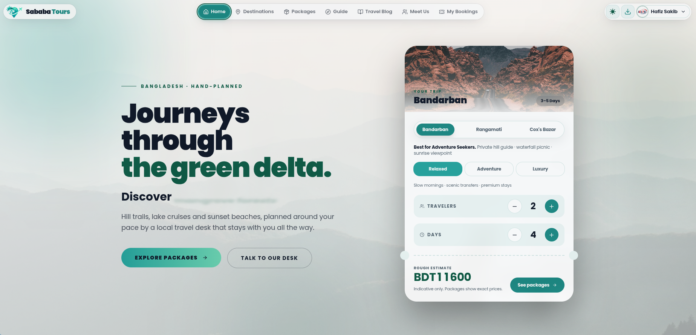

# 🧭 Sababa Tours — Backend API

REST API for the [Sababa Tours](https://sababa-tours.vercel.app/) travel platform. It stores tour packages and bookings in MongoDB, verifies Firebase sign-in tokens, enforces the booking and payment rules (30% advance, 72-hour hold, change window) and gives the travel desk admin endpoints.



*Screenshot of the frontend this API powers.*

---

## ✨ What it does

- 🔐 **Firebase ID-token verification** with `jose` (no service-account key needed)
- 👤 Customer endpoints: create, list, edit, cancel, pay and delete **their own** bookings
- 🛡️ Admin endpoints: list/confirm/cancel/edit/delete any booking, manage packages
- 💳 **Payments:** pay any whole amount up to the balance; marked paid immediately (demo gateway). Receipt details (transaction id, card brand, last four, masked wallet number) are stored on each payment — never full card numbers
- ⏱️ **Advance rule:** admin confirms a booking on a free date → 30% advance due in 72 h, otherwise it **auto-cancels**
- 🔒 **Change window:** customers can edit or cancel only until 5 days before the trip
- ❤️ `/health` endpoint plus a GitHub Action (`keep-alive.yml`) that pings the API every 5 minutes so a free Render instance stays awake

---

## 🛠️ Tech Stack

| Technology | Purpose |
| --- | --- |
| Node.js + Express 4 | HTTP API |
| MongoDB + Mongoose 8 | Data storage |
| `jose` | Verify Firebase ID tokens via Google's public keys |
| `cors`, `dotenv` | CORS and configuration |
| `nodemon` | Dev auto-reload |

---

## 🚀 Getting Started

### 1. Prerequisites
- Node.js 18+
- A MongoDB database (MongoDB Atlas free tier works)
- The Firebase project used by the frontend (only its **project id** is needed)

### 2. Install
```bash
git clone <your-backend-repo-url>
cd Sababa-Tours-Backend-main
npm install
```

### 3. Environment variables
Copy `.env.example` to `.env` and fill it in:

```env
MONGO_URI=mongodb+srv://<user>:<password>@<cluster>/<db>
PORT=5000

# optional
FIREBASE_PROJECT_ID=your_firebase_project_id
ADMIN_EMAILS=admin1@example.com,admin2@example.com
CORS_ORIGINS=https://your-frontend.vercel.app,http://localhost:3000
```

| Variable | Required | Meaning |
| --- | --- | --- |
| `MONGO_URI` | ✅ | MongoDB connection string |
| `PORT` | – | Port to listen on (default `5000`) |
| `FIREBASE_PROJECT_ID` | – | Must match the frontend's Firebase project; tokens from any other project are rejected |
| `ADMIN_EMAILS` | – | Comma-separated admin emails. The Firebase email must also be **verified** |
| `CORS_ORIGINS` | – | Extra allowed origins, comma-separated |

> Keep `.env` out of git (it is in `.gitignore`). If a password was ever committed, rotate it in MongoDB Atlas.

### 4. Run
```bash
npm run dev     # nodemon, auto-reload
npm start       # plain node
```
The API listens on `http://localhost:5000`; check `GET /health`.

---

## 🔑 Authentication

Send the Firebase ID token with every protected request:

```
Authorization: Bearer <firebase-id-token>
```

- `requireAuth` — any signed-in user; bookings are always scoped to the token's user id
- `requireAdmin` — signed-in user whose **verified** email is in `ADMIN_EMAILS`

---

## 📡 API Reference

### Public
| Method | Path | Description |
| --- | --- | --- |
| GET | `/health` | Liveness check |
| GET | `/api/services` | List tour packages |
| GET | `/api/services/:id` | One package |

### Customer (signed in)
| Method | Path | Description |
| --- | --- | --- |
| POST | `/api/bookings` | Create a booking request (status `pending`). Also needs `category`, `traveler`, `hotel`, `flight` (see below) |
| GET | `/api/bookings/user/:userId` | My bookings |
| PATCH | `/api/bookings/:id` | Edit my booking (until 5 days before the trip; a confirmed one returns to `pending`) |
| PATCH | `/api/bookings/:id/cancel` | Cancel my booking (same window) |
| POST | `/api/bookings/:id/pay` | Pay `{ amount, method, ref?, brand?, last4?, account? }` |
| DELETE | `/api/bookings/:id` | Delete my booking (only after it is cancelled) |
| GET | `/api/payments/mine` | My payment history (from the payment ledger) |

`method` is one of `bKash`, `Nagad`, `Card`. `amount` must be a whole number from 1 up to the remaining balance.

### Admin
| Method | Path | Description |
| --- | --- | --- |
| GET | `/api/admin/bookings` | All bookings |
| GET | `/api/admin/payments` | Payment ledger, newest first (`?bookingId=` / `?userId=` to filter) |
| PATCH | `/api/admin/bookings/:id` | Change status (`pending` / `confirmed` / `cancelled`) or edit details |
| DELETE | `/api/admin/bookings/:id` | Delete any booking |
| POST | `/api/admin/services` | Create a package |
| PATCH | `/api/admin/services/:id` | Update a package |
| DELETE | `/api/admin/services/:id` | Delete a package |

---

## 🔄 Booking Lifecycle

```
pending ──(admin confirms, date free)──▶ awaiting_payment ──(30% paid)──▶ confirmed
   │                                          │
   │                                          └─(72 h, advance unpaid)──▶ cancelled (advance_not_paid)
   └──(admin confirms, date taken)──────────────────────────────────────▶ confirmed
any open status ──(customer / admin cancels)──▶ cancelled
```

Payments made so far are kept on a cancelled booking so a refund can be arranged by the travel desk.

---

## 🗃️ Booking Model (summary)

| Field | Notes |
| --- | --- |
| `userId`, `userName`, `userEmail` | Taken from the verified token |
| `serviceName`, `travelers`, `preferredDate`, `totalAmount` | Trip details |
| `status` | `pending`, `awaiting_payment`, `confirmed`, `cancelled` |
| `advanceAmount`, `payDeadline`, `confirmedAt` | Set when the admin confirms |
| `cancelReason` | `advance_not_paid`, `customer`, `admin` |
| `paidAmount`, `payments[]` | Each payment: `amount`, `method`, `ref`, `brand`, `last4`, `account`, `currency`, `status`, `payerName`, `payerEmail`, `balanceAfter`, `paidAt` |
| `category` | `Family`, `Couple`, `Friends`, `Solo`, `Corporate` |
| `traveler` | `fullName` (lead traveler), `nationality`, `children` (adults = travelers − children), `emergencyName`, `emergencyPhone` |
| `hotel` | `needed` (false = own stay); when true: `roomType` (Standard / Deluxe / Family Suite / Luxury Suite), `rooms`, `bedType`, `mealPlan`, `nights`, `requests`. Check-in is the trip date |
| `flight` | `mode`: `own` (`airline`, `flightNo`, `arrivalTime`, `departFrom`, optional `returnFlightNo` / `returnDate`), `arrange` (`departFrom`, `cabin`, `roundTrip`) or `none` |

All of the above is validated on the server in `extras.js`. Hotel and flight choices are requests: they do **not** change the package total, and the travel desk confirms rooms and fares with the customer. Bookings made before these fields existed still load; the fields are simply empty.

### Payment data
Every payment is saved twice: inside the booking (`payments[]`) and as its own document in the `payments` collection (a ledger that stays even if the booking is later deleted). Only what the receipt shows is kept: method, reference, card brand + last four digits, masked wallet number, amount and balance. **Full card numbers, CVC and wallet PINs are never sent to or stored by the server.** This build records payments made through the demo payment flow; connect a real payment gateway before taking real money.

---

## 📂 Project Structure

```bash
Sababa-Tours-Backend-main/
├── server.js                   # app, models (Booking, Payment, Service), auth, routes, expiry sweep
├── extras.js                   # validation of category / traveler / hotel / flight
├── package.json
├── .env.example
├── assets/homepage.png         # README screenshot
├── SETUP.txt                   # notes for hidden files on GitHub uploads
└── .github/workflows/
    └── keep-alive.yml          # pings /health every 5 minutes
```

---

## 🌍 Deployment (Render)

1. Create a **Web Service** from this repo — build command `npm install`, start command `npm start`.
2. Add `MONGO_URI` (and optionally `FIREBASE_PROJECT_ID`, `ADMIN_EMAILS`, `CORS_ORIGINS`) in **Environment**.
3. Allow Render's IPs in MongoDB Atlas network access.
4. Point the frontend's production URL (`src/config.js`) to your service.
5. Free Render instances sleep when idle: the included GitHub Action calls `/health` every 5 minutes (GitHub may delay a run; it can also pause scheduled workflows after 60 days without repo activity, so re-enable it in the **Actions** tab if that happens), and expired bookings are also swept on each booking list / pay request.

---

## 🔗 Related

- **Frontend repo:** Sababa Tours (React) — set up first, it needs this API on port `5000` in development

Built by **Hafiz Sakib** · [Portfolio](https://hafizsakib.vercel.app/)


## Travel Blog
New `blogs` collection, admin routes and a seed: see `seed/BLOG_GUIDE.md` (`npm run seed:blogs`).
